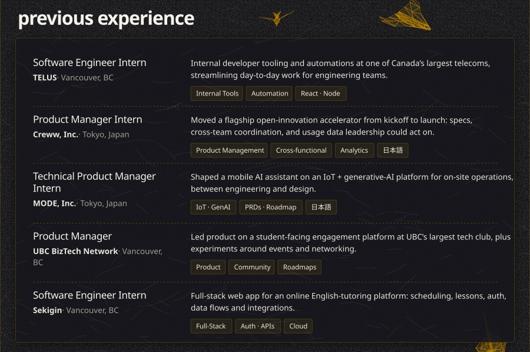
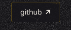

<picture>
  <source media="(prefers-color-scheme: dark)" srcset="assets/hero-dark.svg">
  <source media="(prefers-color-scheme: light)" srcset="assets/hero-light.svg">
  
</picture><!--
--><a href="https://www.linkedin.com/in/hikaruun/" target="_blank" rel="noreferrer"><picture><source media="(prefers-color-scheme: dark)" srcset="assets/btn-linkedin-dark.svg"><source media="(prefers-color-scheme: light)" srcset="assets/btn-linkedin-light.svg"></picture></a><!--
--><a href="https://hikaruun.com" target="_blank" rel="noreferrer"><picture><source media="(prefers-color-scheme: dark)" srcset="assets/btn-site-dark.svg"><source media="(prefers-color-scheme: light)" srcset="assets/btn-site-light.svg"></picture></a><!--
--><picture>
  <source media="(prefers-color-scheme: dark)" srcset="assets/about-dark.svg">
  <source media="(prefers-color-scheme: light)" srcset="assets/about-light.svg">
  
</picture><!--
--><picture>
  <source media="(prefers-color-scheme: dark)" srcset="assets/experience-dark.svg">
  <source media="(prefers-color-scheme: light)" srcset="assets/experience-light.svg">
  
</picture><!--
--><picture>
  <source media="(prefers-color-scheme: dark)" srcset="assets/project-dark.svg">
  <source media="(prefers-color-scheme: light)" srcset="assets/project-light.svg">
  
</picture><!--
--><a href="https://devpost.com/software/soterra-mtz1rv" target="_blank" rel="noreferrer"><picture><source media="(prefers-color-scheme: dark)" srcset="assets/btn-devpost-dark.svg"><source media="(prefers-color-scheme: light)" srcset="assets/btn-devpost-light.svg"></picture></a><!--
--><a href="https://github.com/lhurepo/soterra" target="_blank" rel="noreferrer"><picture><source media="(prefers-color-scheme: dark)" srcset="assets/btn-github-dark.svg"><source media="(prefers-color-scheme: light)" srcset="assets/btn-github-light.svg"></picture></a><!--
--><a href="https://soterra-calhacks13.netlify.app/" target="_blank" rel="noreferrer"><picture><source media="(prefers-color-scheme: dark)" srcset="assets/btn-live-dark.svg"><source media="(prefers-color-scheme: light)" srcset="assets/btn-live-light.svg"></picture></a><!--
--><picture>
  <source media="(prefers-color-scheme: dark)" srcset="assets/stats-dark.svg">
  <source media="(prefers-color-scheme: light)" srcset="assets/stats-light.svg">
  
</picture><!--
--><a href="https://hikaruun.com" target="_blank" rel="noreferrer">
  <picture>
    <source media="(prefers-color-scheme: dark)" srcset="assets/footer-dark.svg">
    <source media="(prefers-color-scheme: light)" srcset="assets/footer-light.svg">
    
  </picture>
</a>

